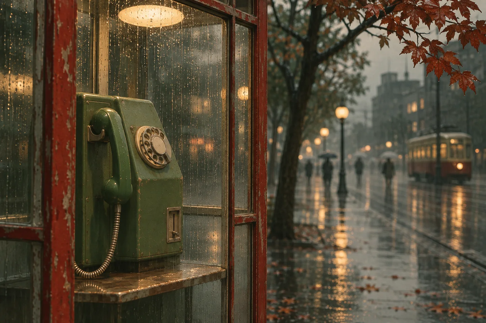

*AI 生成配图*

读《挪威的森林》时，绿子一直让我有点替她着急。渡边愿意走近她，也会和她说很多话。但当两个人的关系需要一个明确的答复，他又总有一部分心思留在直子那里。读到最后，我还是忍不住想，如果直子一直在，渡边会在什么时候作出选择？

*下文涉及小说结尾。*

## 排在第二位是什么感觉

渡边和直子有一段绕不开的共同过去。他们都经历过木月的离去。即便相处得吃力，渡边也一直想要理解她，去探望她。绿子这边却是正在发生的生活。她愿意和渡边亲近，也明确希望他能认真回应自己。两个人明明很近，未来又总悬着，这一点最让我替她着急。

我以前在笔记里用「备胎」形容绿子。这个词说出了我当时读到的不平衡，但也把她说得太被动了。绿子会追问，会表达自己想要什么，也会在受伤以后和渡边拉开距离。正因为她是这样一个人，我才更在意渡边什么时候能真的把她当成眼前要回应的人。

## 电话打通之后

直子死后，渡边最后打电话给绿子，告诉她想要和她在一起。绿子问他人在哪里。他抬起头，却说不清自己身在何处。小说到这里停下，留下了渡边的选择，也留下了他还没能回答的问题。

如果只读到他拨通电话，可能会觉得绿子终于等到了。但我更在意她那句追问。她当然可以想知道他人在哪里。我也会跟着想，一个人终于知道要找谁的时候，是否已经准备好走到对方身边？读完以后，我对这段关系的犹豫就留在这里。

[出版社的《挪威的森林》阅读指南](https://www.penguinrandomhouse.com/books/118720/norwegian-wood-by-haruki-murakami/readers-guide/)
