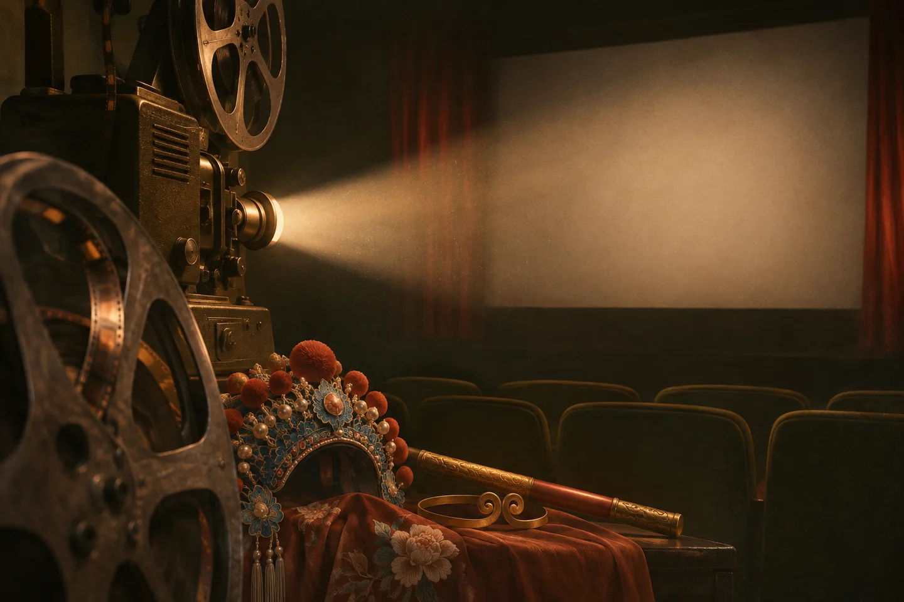

*AI 生成配图*

有些电影的情节已经记得差不多了，再放一遍，还是会让人愿意看下去。想到这种电影，我会想到《霸王别姬》和《大话西游》。知道后面会发生什么以后，原先一带而过的动作和对白，反倒变得更显眼。

我以前把这种感觉归到「信息密度」上。现在想想，一部电影有多少件事发生，只能解释一部分。更有意思的是，同一场戏看过两遍，第二遍会让人想到第一遍没想到的东西。

*下文涉及两部作品的情节。*

## 《霸王别姬》：同一出戏唱了半辈子

《霸王别姬》从程蝶衣、段小楼小时候在戏班学戏讲起，一路讲到两人成角、聚散。以 Criterion 收录的修复版为例，171 分钟里跨过了约半个世纪。我觉得它能讲得这么满，很大程度上是因为它总能把那么多年的变化拉回同一个戏台上。 [Criterion 影片资料](https://www.criterion.com/films/34098-farewell-my-concubine)

小时候，一句戏词念对念错，是程蝶衣怎么学成一个角儿的事。后来他和段小楼一同演《霸王别姬》，同样的戏又成了两人维系关系的地方。台上他们一次次演霸王和虞姬，台下却各自有了生活，能留给对方的位置也在变。

等看到两人多年后再同台，开头那些练戏的场面就有了另一层意思。回头再看，会忍不住留意他们最初是怎么学会搭戏的，又是在什么时候开始把这段关系看成了不同的东西。戏还是那出戏，几十年过去，台上的两个人已经没法用原来的心情唱它了。

## 《大话西游》：回到过去也有来不及的时候

至尊宝反复用月光宝盒回到过去，想救白晶晶。那几次折返本身就很好笑。明明能重来，事情却一次也没按他想的发生。直到他回到五百年前遇见紫霞，原先只是用来救人的宝盒，又把他带进了另一段关系。 [香港电影资料馆《月光宝盒》](https://www.filmarchive.gov.hk/en/web/hkfa/2026/ccf-journeys-to-the-west/pe-event-2026-ccf-journeys-to-the-west-fs-film01.html) · [《仙履奇缘》](https://www.filmarchive.gov.hk/tc/web/hkfa/2026/ccf-journeys-to-the-west/pe-event-2026-ccf-journeys-to-the-west-fs-film02.html)

知道后来他和紫霞的结局，再看开头那些狼狈的重来，很容易多想一步。他总觉得还有办法把时间拨回去，补上刚才的失误。可即使真能回去，人已经遇见了，感情已经变了，接下来想救的人也会变。笑点还在，里面多了一点后来才觉出来的着急。

## 什么样的细节值得再看

有些电影节奏很快，每隔几分钟就抛出一件新事，第一次看很过瘾。还有些电影会给同一个细节留一点时间，让它隔了几场戏、甚至隔了大半部电影，再出现一次。第二次出现时，观众心里已经多了前面攒下来的东西。

这大概就是这两部电影值得重看的地方。《霸王别姬》让我回头看两个人怎么唱同一出戏，《大话西游》让我回头看一个人为什么总想重来。故事已经知道了，还能对同一个画面生出一点新感觉。电影放完之后，这些细节才慢慢显出分量。
